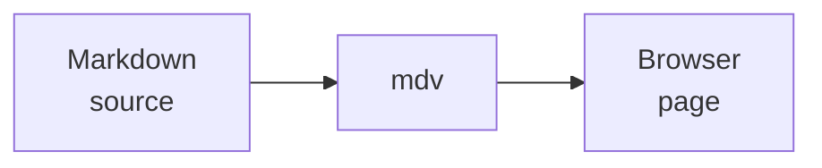
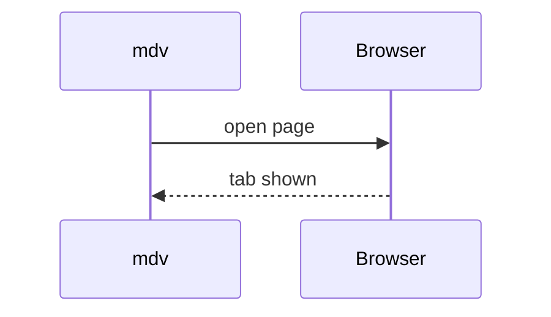

# mdv fixture

This paragraph contains ~~removed text~~ and an autolink: https://example.com.

## Task list

- [x] Render Markdown
- [ ] Inspect the result

## Table

| Feature | Status |
| --- | --- |
| GFM | Ready |
| Relative image | Ready |

## Code

```go
fmt.Println("mdv")
```


<script>alert("raw HTML must not render")</script>

## Diagram



<details>
<summary>Diagram inside details</summary>



</details>
